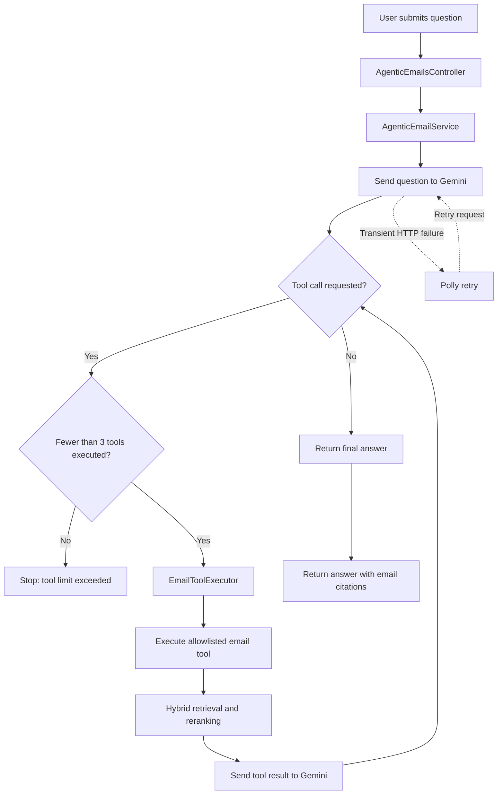

# Inbox Intelligence

Inbox Intelligence is an email intelligence backend that lets users ask natural-language questions about emails stored in a database and receive context-aware answers grounded in email evidence.

It uses **Retrieval-Augmented Generation (RAG)** with PostgreSQL and pgvector for semantic search, hybrid retrieval combining semantic and keyword search, and Reciprocal Rank Fusion (RRF) to rerank results. Gemini generates answers with supporting email citations.

**V2 — Agentic Retrieval:** Extends the retrieval pipeline with Gemini-powered tool orchestration. The model can dynamically select from allowlisted email tools, inspect retrieved evidence, and perform up to three tool executions per request before producing a final answer. Polly-based HTTP resilience retries transient failures when communicating with Gemini.

## V2 Retrieval Flow

### Available tools

- `SearchSimilarEmails` — retrieves relevant emails using the search pipeline.
- `GetConversationEmails` — retrieves emails belonging to a conversation.
- `GetEmailsByContact` — retrieves emails associated with a contact.

### Key design points

- **Grounded answers:** Responses should be based on retrieved email evidence and include message-ID citations.
- **Bounded orchestration:** A maximum of three tool executions per request prevents unbounded tool loops.
- **Hybrid retrieval:** Semantic and keyword search results are combined and reranked using RRF.
- **Resilience:** Polly retries transient HTTP failures from the Gemini client.
