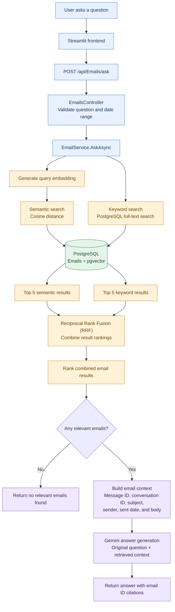

# Inbox Intelligence — V1

**An Email Intelligence System Powered by Retrieval-Augmented Generation (RAG)**

Inbox Intelligence is a backend application that enables users to ask natural-language questions about the contents of an email mailbox and receive accurate, context-aware answers grounded in the emails stored in its database.

The system uses semantic search and keyword-based retrieval to identify relevant emails, retrieves additional context from related conversations, and provides the selected evidence to a Large Language Model (LLM) to generate answers with source citations.

## Retrieval Flow

The diagram below shows the current retrieval and answer-generation flow. Query rewriting and automatic contact extraction are planned enhancements and are not yet part of this flow.

### How retrieval works

1. **Semantic search** generates an embedding for the user's question and retrieves the closest email vectors.
2. **Keyword search** uses PostgreSQL full-text search over email subjects and bodies.
3. **Contact and date filters**, when supplied, constrain both retrieval paths.
4. **Reciprocal Rank Fusion (RRF)** combines the two ranked result lists into one ranking.
5. **Answer generation** sends the original question and retrieved email context to Gemini. The model is instructed to answer from the supplied evidence and cite supporting emails using their `ExternalMessageId`.
