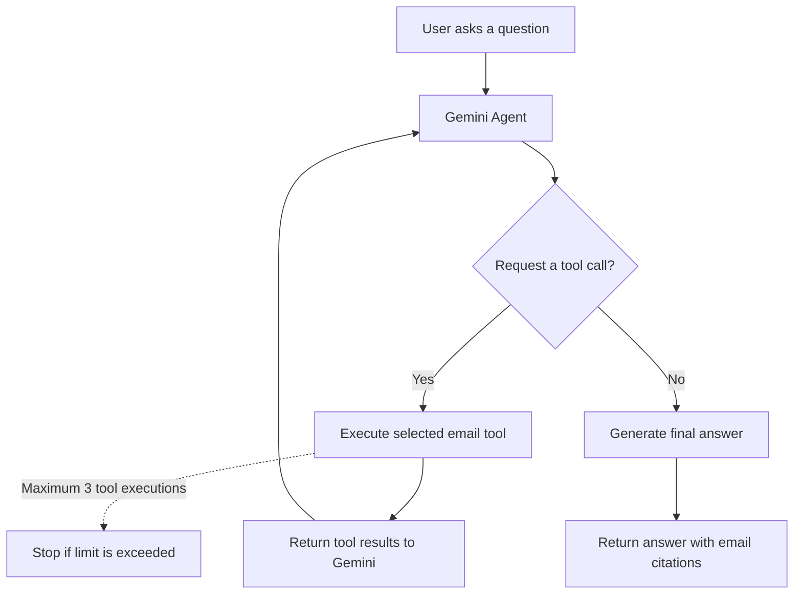

# Inbox Intelligence

Inbox Intelligence is an email intelligence backend that lets users ask natural-language questions about emails stored in a database and receive context-aware answers grounded in email evidence.

It uses **Retrieval-Augmented Generation (RAG)** with PostgreSQL and pgvector for semantic search, hybrid retrieval combining semantic and keyword search, and Reciprocal Rank Fusion (RRF) to rerank results. Gemini generates answers with supporting email citations.

**V2 — Agentic Retrieval:** Extends the retrieval pipeline with Gemini-powered tool orchestration. The model can dynamically select from allowlisted email tools, inspect retrieved evidence, and perform up to three tool executions per request before producing a final answer. Polly-based HTTP resilience retries transient failures when communicating with Gemini.

## V2 — Agentic Retrieval Flow

### Available tools

- `SearchSimilarEmails` — retrieves relevant emails using the search pipeline.
- `GetConversationEmails` — retrieves emails belonging to a conversation.
- `GetEmailsByContact` — retrieves emails associated with a contact.

### Key design points

- **Grounded answers:** Responses should be based on retrieved email evidence and include message-ID citations.
- **Bounded orchestration:** A maximum of three tool executions per request prevents unbounded tool loops.
- **Hybrid retrieval:** Semantic and keyword search results are combined and reranked using RRF.
- **Resilience:** Polly retries transient HTTP failures from the Gemini client.

## Retrieval Evaluation Results

The retrieval pipeline was evaluated against a fixed golden dataset of 12 questions using the real PostgreSQL + pgvector retrieval implementation and Gemini-generated query embeddings. The evaluation measures the final ranking produced by hybrid retrieval (semantic search + PostgreSQL full-text search) combined with Reciprocal Rank Fusion (RRF).

### Benchmark results

| Metric | Result |
|---|---:|
| Answerable questions evaluated | 10 |
| Mean Recall@5 | **1.0000 (100%)** |
| Mean Reciprocal Rank (MRR) | **1.0000** |
| Unanswerable questions | 2 (excluded from retrieval metrics) |

All 10 answerable questions achieved Recall@5 = 1.00 and MRR = 1.00 on this dataset. In other words, every expected supporting email for each answerable question appeared within the top five final results, and the first relevant email was ranked first.

### Evaluation methodology

- Each golden question is associated with its expected supporting `ExternalMessageId` values.
- The evaluation calls the production `EmailService.GetSimilarEmailsAsync` method, so it exercises query embedding generation, semantic retrieval, keyword retrieval, and final RRF ranking.
- Metrics are calculated over the first five results of the final RRF-ranked list.
- **Recall@5** measures the fraction of expected supporting emails present in the top five results.
- **Reciprocal Rank** is the inverse rank of the first relevant result; MRR is its mean across answerable questions.
- The two questions with no expected supporting message IDs are excluded from Recall@5 and MRR. They are reserved for a separate abstention evaluation.

### Scope and limitations

These results describe performance on the current 12-question golden dataset; they are not a guarantee of accuracy on arbitrary mailboxes or unseen questions. The two unanswerable questions have not yet been evaluated for abstention behavior, and answer correctness, faithfulness, and citation accuracy are separate end-to-end RAG evaluation dimensions.

